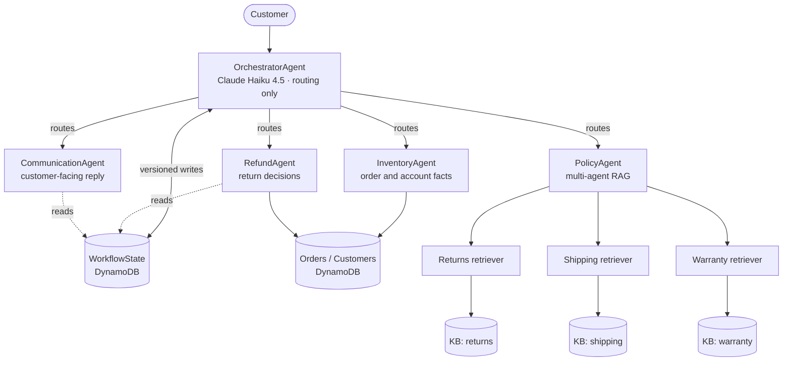
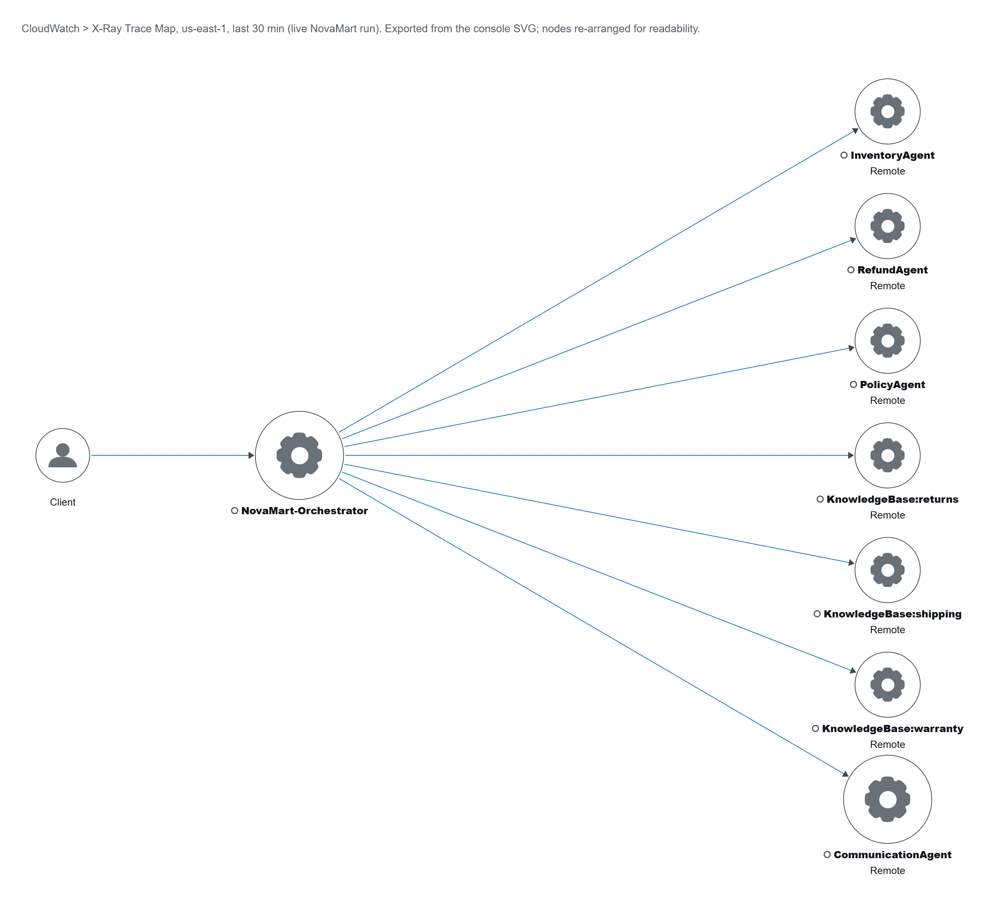

# NovaMart: multi-agent customer support with RAG on Amazon Bedrock AgentCore

Five cooperating AI agents that handle an e-commerce store's support requests: order lookups, returns and refunds, and policy questions answered from three knowledge bases searched in parallel. Built with the **Strands Agents SDK** and deployed to **Amazon Bedrock AgentCore Runtime**, with guardrails, memory and X-Ray tracing.


> Capstone project of the *Multi-Agent Systems and Protocol Integration on AWS* course in Udacity's
> [Future AWS Agent Engineer Nanodegree](https://www.udacity.com/scholarships/aws-ai-ml-scholars).
> My notes and the other projects from the program: **[aws-agent-engineer-notes](https://github.com/ahmedEid1/aws-agent-engineer-notes)**.

## Origin

Built for the Future AWS Agent Engineer Nanodegree on Udacity's starter code (`project/starter` in [udacity/cd14764-aws-agentic-c3-classroom](https://github.com/udacity/cd14764-aws-agentic-c3-classroom/tree/main/project/starter)).

- **From the starter, unchanged:** the CloudFormation stack, seed and cleanup scripts in `infrastructure/`, `config.py`, `requirements.txt`, the helper modules in `src/` (`agent_observability.py`, `agent_utils.py`, `agentcore_cli.py`, `bedrock_kb_retrieval.py`, `demo.py`), the AgentCore CLI project in `agentcore/`, the diagrams in `docs/diagrams/` and the grading suite `tests/test_agent.py`.
- **From the starter, completed by me:** `src/agent_orchestrator.py` came with the shared-state helpers and the command-line entry points, and TODOs for the rest. I wrote the five agents and three retrievers with their prompts and tools, the routing tools, the guardrail, the runtime deployment, and the Memory and logging setup.
- **Mine:** the `offline_checks/` suite and the screenshots in `docs/images/`.

## What it does

| Customer asks | Agents involved | Outcome (live run) |
|---|---|---|
| "I want to return my headphones from order ORD-27176" | Orchestrator → Inventory → Refund → Communication | Return **approved** within the Premium 60-day window, `RET-…` reference and next steps |
| "What is the return policy for premium customers?" | Orchestrator → Policy (3 KBs in parallel) → Communication | 60-day window, answer grounded in the policy documents with sources |
| "How much are 5 items at $29.99 with 10% off?" | Orchestrator → Communication | **$134.96** (exact total, rounded once at the end) |

## Architecture



- **Orchestrator** (Claude Haiku 4.5, temperature 0) only routes. It never writes the reply itself. Workers run on Claude Sonnet 4.5.
- **Shared state, not shared chat history:** every routing tool reads the session's `WorkflowState` row, runs one worker on a fresh conversation, and writes the result back with a conditional (versioned) update.
- **Multi-agent RAG:** three retriever sub-agents query three Bedrock Knowledge Bases (Titan Embed v2, S3 Vectors) concurrently. Their passages are merged, de-duplicated and ranked by score. One failing KB is reported without losing the other two.
- **The five agents' model calls run behind a Bedrock Guardrail.** The retriever sub-agents only relay knowledge-base passages. The whole graph is served from **AgentCore Runtime**. The deploy pipeline also provisions **AgentCore Memory** (session-summary strategy) and turns on **X-Ray / CloudWatch** observability.



## Design decisions

- **The model decides, the code enforces.** `initiate_refund` re-checks delivery status, the tier's return window (Premium 60 / Standard 30 days from delivery) and duplicate returns before writing. A DynamoDB condition (`#status = :delivered`) makes a double return impossible even under concurrency. Date arithmetic is done in code (`days_since_delivery`), never by the LLM.
- **Deterministic tool order.** The orchestrator uses Strands' `SequentialToolExecutor`, so the RefundAgent can never read `WorkflowState` before the InventoryAgent has written it, even if the model requests both tools in one turn.
- **No cross-customer leakage.** Workers start every request with a cleared conversation, and a follow-up message in the same session resets the previous request's findings (also under optimistic locking).
- **Guardrail as a versioned artifact.** It's published as a numbered version (never `DRAFT`), and `verify_guardrail()` runs allow/block examples through `apply_guardrail` at deploy time. The topic definitions block price negotiation, competitors and legal threats while still allowing arithmetic on a stated price.
- **Privacy by default.** Customer emails never enter the conversation, and the CommunicationAgent is told never to echo card numbers or SSNs. The guardrail blocks cards/SSNs and anonymizes emails and phone numbers.

## Results

- **120/120** on the course's grading suite (`tests/test_agent.py all`) against the live AWS deployment. [Screenshot](docs/images/test_results_120.png)
- X-Ray trace map: Orchestrator → the four worker agents and three `KnowledgeBase:*` nodes. The [span timeline](docs/images/xray_trace_timeline.png) shows the three retrievers running in parallel.
- **12 offline checks** (`offline_checks/`) that need no AWS account:
  - DynamoDB runs on moto with the real stack's tables and seed data;
  - guardrail, `apply_guardrail` and AgentCore Memory requests are validated against the real API models through botocore Stubbers;
  - scripted stand-ins replace the LLMs, so all the tool code runs for real.

> The AWS resources were deployed and verified in September 2026 and have since been torn down.

## Tech stack

Python 3.12 · Strands Agents SDK · Amazon Bedrock (Claude Haiku 4.5 / Sonnet 4.5, Knowledge Bases, Guardrails) · Amazon S3 Vectors · Bedrock AgentCore (Runtime, Memory, observability) · DynamoDB · CloudFormation · AgentCore CLI + CDK · AWS X-Ray / CloudWatch · moto

## Repository layout

```text
src/agent_orchestrator.py    the five agents + three retrievers, guardrail, deployment, CLI entry points
src/agent_observability.py   X-Ray subsegments per tool call, CloudWatch logging
src/agent_utils.py           terminal trace UI for `chat`
src/agentcore_cli.py         wrapper around the AgentCore CLI (stage code, configure, deploy)
src/bedrock_kb_retrieval.py  Knowledge Base retrieve helper
config.py                    settings; resolves AWS resources from the CloudFormation stack's exports
infrastructure/              CloudFormation stack, seed data, cleanup script
agentcore/                   AgentCore CLI project (agentcore.json + generated CDK app)
tests/test_agent.py          the course's grading suite (120 points)
offline_checks/              my offline verification suite (moto + botocore Stubbers)
docs/                        diagrams and screenshots
```

## Run it

Prerequisites: an AWS account with Bedrock access to Claude Haiku 4.5, Claude Sonnet 4.5 and Titan Embed Text v2 in `us-east-1`; Python 3.12; Node.js 20+ and `uv` for the AgentCore CLI (`npm install -g @aws/agentcore@0.30.0`).

```bash
python -m venv .venv && source .venv/bin/activate      # Windows: .venv\Scripts\activate
pip install -r requirements.txt

# Offline checks: no AWS account needed
pip install moto
python offline_checks/test_project_offline.py

# Live deployment
aws cloudformation deploy --template-file infrastructure/starter_stack.yaml \
  --stack-name udacity-agentcore --capabilities CAPABILITY_NAMED_IAM --region us-east-1
python infrastructure/seed_data.py
cp .env.example .env            # then create the 3 Knowledge Bases and put their IDs in .env
python src/agent_orchestrator.py deploy     # guardrail, AgentCore Runtime, Memory, observability
python src/agent_orchestrator.py test       # the three scenarios, each traced to X-Ray
python src/agent_orchestrator.py chat       # interactive session with a live agent trace
python tests/test_agent.py all              # grading suite

python infrastructure/cleanup.py --yes      # tear everything down
```

## Credits and license

[Origin](#origin) lists which parts came from Udacity's starter and which are mine. Udacity's starter material is licensed under the terms in [LICENSE.md](LICENSE.md) (CC BY-NC-ND 4.0 with Udacity's modifications).
